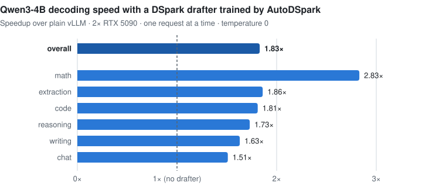
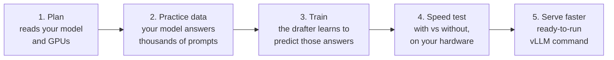

<div align="center">

# AutoDSpark

### Make your own LLM answer up to 2.8x faster.

**One command trains a small helper model that speeds up your LLM.<br>Same answers, much less waiting.**

[](#-results)
[](LICENSE)
[](https://github.com/vllm-project/vllm)
[](docs/guide.md#roadmap)

[Results](#-results) | [How it works](#-how-it-works) | [Get started](#-get-started) | [Full guide](docs/guide.md)

</div>

<p align="center">
  
</p>

<p align="center"><sub>Qwen3-4B on 2× RTX 5090: <b>165 → 303 tokens/s</b> overall, <b>165 → 467 tokens/s</b> on math.</sub></p>

## ✨ What you get

- **Faster answers.** In our Qwen3-4B test, replies came 1.5x to 2.8x faster, depending on the
  task.
- **Exactly the same answers.** Nothing about your model changes: same weights, same quality.
- **Made for *your* model.** Works for fine-tuned and less common models that have no ready-made
  speed-up available.
- **One command, a few hours, your own GPUs.** No cluster, no machine-learning expertise needed.

## 📊 Results

We trained a helper for **Qwen3-4B** with AutoDSpark on two RTX 5090 graphics cards. It took
under 3 hours from start to finish. Then we asked the model the same questions with and without
the helper and timed it:

| Task | Before (tokens/s) | After (tokens/s) | Faster by |
|---|---|---|---|
| Math | 165 | 467 | **2.83x** |
| Information extraction | 165 | 306 | 1.86x |
| Code | 165 | 299 | 1.81x |
| Reasoning | 165 | 288 | 1.73x |
| Writing | 165 | 270 | 1.63x |
| Chat | 165 | 250 | 1.51x |
| **Overall** | **165** | **303** | **1.83x** |

A token is roughly three quarters of an English word. Tasks with predictable output, like math,
code and data extraction, speed up the most. Training on examples from your own use case makes
the helper faster still. Full test setup: [guide](docs/guide.md#reproducing-the-qwen3-4b-result).

## 💡 How it works

**Why LLMs are slow.** A language model writes one token at a time, and every single token needs
a full pass through the whole model. A 500-token answer means 500 passes, one after another.

**The trick: draft, then check.** AutoDSpark trains a small, fast *drafter* that guesses the
next several tokens at once. Your model then checks the whole guess in **one** pass, the same
cost as writing a single token. Every correct guess is kept; at the first wrong one, your model
puts in its own token instead. So you get several tokens for the price of one, and the final
answer is exactly what your model would have written alone. This technique is called
*speculative decoding*; AutoDSpark uses [DSpark](https://arxiv.org/abs/2607.05147), a recent
drafter design from DeepSeek-AI and Peking University.

**Why you need your own drafter.** A drafter is only fast if it guesses well, and it only guesses
well if it knows your model's habits. Ready-made drafters exist for a few popular models; for
anything else, including models you fine-tuned yourself, you have to train one. That used to
mean hand-tuning a dozen settings. AutoDSpark does all of it with one command:



Under the hood, training is done by [vLLM Speculators](https://github.com/vllm-project/speculators)
and serving by [vLLM](https://github.com/vllm-project/vllm). The [guide](docs/guide.md#how-it-works)
explains each step in detail.

## ⚡ Get started

You need a Linux machine with an NVIDIA GPU and your model in Hugging Face format.

```bash
git clone https://github.com/Zihao-Wu06/AutoDSpark.git && cd AutoDSpark
pip install -e . && autodspark setup                    # one-time install
autodspark run --model Qwen/Qwen3-8B --preset medium    # train, test, report
```

When it finishes, the report shows how much faster your model got, and this command serves it
with the speed-up switched on:

```bash
autodspark serve --workdir runs/Qwen3-8B-medium        # prints the vllm serve command
```

**For the best speed on your use case,** add a file of example prompts like the ones your users
send: `--data my_prompts.jsonl`. See the [guide](docs/guide.md#usage) for presets, data formats
and every option.

Prefer to have an AI assistant do it? The included [Claude Code skill](docs/guide.md#use-it-with-claude-code)
runs the whole workflow for you.

## ❓ FAQ

**Will my model's answers change?**
No. Your model checks every drafted token, so the output is identical to running it without the
helper. Only the speed changes.

**What hardware do I need?**
One NVIDIA GPU is enough for small and mid-size models. More GPUs make training faster.

**How long does training take?**
A few hours for a first real helper (the Qwen3-4B result above took under 3 hours on two
RTX 5090s). A 15-minute `--preset quick` run checks that everything works on your machine.

**Which models are supported?**
Models in Hugging Face format that vLLM can serve. Verified so far on Qwen3; others are
[listed in the guide](docs/guide.md#supported-models).

**Does it speed up a busy server too?**
The numbers above are for one request at a time, where the speed-up is largest. With many
requests at once the GPU is already busy and the gain is smaller.

## 📚 Learn more

- [Full guide](docs/guide.md): installation, options, how it works, limitations and roadmap
- [DSpark paper](https://arxiv.org/abs/2607.05147)
- Issues and pull requests are welcome, especially results from models and GPUs we haven't tested.

## 🙏 Acknowledgements

DSpark is by DeepSeek-AI and Peking University ([paper](https://arxiv.org/abs/2607.05147),
[DeepSpec](https://github.com/deepseek-ai/DeepSpec)). Training and serving are done by
[vLLM Speculators](https://github.com/vllm-project/speculators) and [vLLM](https://github.com/vllm-project/vllm).
AutoDSpark is an independent project and is not affiliated with them.

## 📃 Citation

```bibtex
@software{autodspark2026,
  title  = {AutoDSpark: One-Command DSpark Drafter Training for Your Own Model},
  author = {{AutoDSpark contributors}},
  year   = {2026},
  url    = {https://github.com/Zihao-Wu06/AutoDSpark}
}
```

## License

[Apache-2.0](LICENSE)
