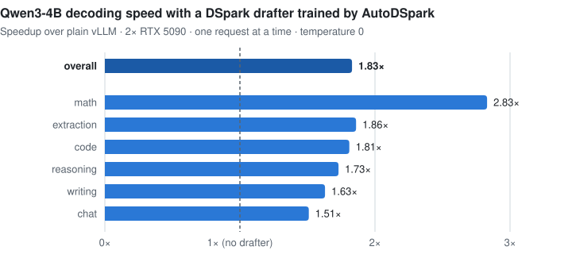

<div align="center">

# AutoDSpark

**一条命令，为你自己的模型训练 [DSpark](https://arxiv.org/abs/2607.05147) 投机解码草稿模型，然后用 vLLM 跑得更快。**

[](LICENSE)
[](pyproject.toml)
[](https://github.com/vllm-project/vllm)
[](https://github.com/vllm-project/speculators)
[](#-路线图)

[快速开始](#-快速开始) | [实测结果](#-实测结果) | [工作原理](#-工作原理) | [Claude Code skill](#-配合-claude-code-使用) | [English](README.md)

</div>

<p align="center">
  
</p>

<p align="center"><sub>Qwen3-4B，<code>--preset medium</code>，在 2 张 RTX 5090 上端到端不到 3 小时训完。</sub></p>

```bash
autodspark run --model /models/my-finetuned-qwen3-8b
```

## 🎉 动态

- **[2026/11]** 第一个正式结果：用 `medium` 档为 **Qwen3-4B** 训练的草稿模型，让单路生成整体**提速 1.83 倍**，数学题**提速 2.83 倍**。在 2 张 RTX 5090 上端到端约 2 小时 50 分钟。详见[实测结果](#-实测结果)。
- **[2026/11]** 流程验证：Qwen3-0.6B 用 `--preset quick` 在单张 RTX 5090 上端到端跑通，约 15 分钟。

## 📍 简介

投机解码能让大模型生成得更快，而且不改变输出：一个小的草稿模型先猜几个 token，目标模型做一次前向计算就能把它们全部验证完。DSpark 是一种按块并行的草稿模型，一次猜出一整块 token。

官方训好的 DSpark 草稿模型只覆盖少数热门模型。如果你微调过模型，或者用的模型没人训过草稿模型，现成的草稿模型和你的模型对不上，接受率就会下降，只能自己训。

训练代码其实已经有了：[vLLM Speculators](https://github.com/vllm-project/speculators)、[DeepSpec](https://github.com/deepseek-ai/DeepSpec)、[SpecForge](https://github.com/sgl-project/SpecForge) 等都实现了 DSpark。但每换一个模型，配置工作都要你自己做，AutoDSpark 自动化的就是这一层。它读取模型配置和显卡信息，生成训练方案，然后跑完全流程：用你的模型重新生成训练数据，训练草稿模型，与原模型对比测速，最后给出 `vllm serve` 命令。它不重写训练算法，底层调用的是 Speculators，上游的改进你可以直接受益。

| | 直接用 Speculators | AutoDSpark |
|---|---|---|
| 换新模型 | 复制示例脚本，手改约 15 个参数 | `autodspark run --model ...` |
| 目标层号 | vLLM 和训练两边手动保持一致（填错不会报错，只会训出坏模型） | 只生成一次，各处统一使用 |
| 单卡 | 自己算显存怎么分 | 自动让 vLLM 和训练共用 |
| 显存不足 | 改参数重来 | 自动缩小参数重试 |
| 中途崩溃 | 部分步骤能续跑 | 每一步都能续跑 |
| 有没有加速 | 另外跑测试 | 最后自动出对比报告 |

## ✨ 特点

- **一条命令跑完全流程。** 规划、重新生成数据、准备数据、训练、测速、出报告。
- **你的模型，你的数据。** 可以把自己的提示词和公开数据集混在一起用。每条回答都由你的模型重新生成，草稿模型学到的是你的模型真正会说的话。
- **适配你手上的 GPU。** 单卡时 vLLM 和训练共用一张卡；多卡时数据并行生成、多卡训练；显存紧张时切换到离线模式。
- **不容易跑坏。** 每一步都能续跑；改了方案只重跑受影响的步骤；显存不足会自动缩小参数重试。
- **用实测说话。** 每次运行最后都会在你的硬件上对比测速。
- **能交给 AI 代理。** 附带 Claude Code skill，可以替你跑完流程、修复常见问题。

## 📊 实测结果

加速比由 AutoDSpark 自带的 `eval` 阶段测量：用 vLLM 分别部署不带和带草稿模型的版本，逐条发送相同的提示词。

| 目标模型 | GPU | 预设 | 训练数据 | 端到端用时 | 接受长度 | 加速比 |
|---|---|---|---|---|---|---|
| Qwen3-4B | 2× RTX 5090（32GB） | `medium` | 1 万条 open-perfectblend | 2 小时 50 分 | 2.25 | **1.83x** |

按任务类别：

| 类别 | 原模型 tok/s | 带 DSpark tok/s | 加速比 |
|---|---|---|---|
| 数学 | 165.3 | 467.5 | **2.83x** |
| 信息抽取 | 165.1 | 306.3 | 1.86x |
| 代码 | 165.0 | 299.1 | 1.81x |
| 推理 | 165.9 | 287.7 | 1.73x |
| 写作 | 165.8 | 270.1 | 1.63x |
| 聊天 | 165.4 | 249.7 | 1.51x |
| **整体**（34 条） | 165.4 | 302.6 | **1.83x** |

接受长度是目标模型每做一次前向计算平均产出的 token 数（1.0 表示没有投机）。输出越规整、越好预测（数学、信息抽取、代码），加速越明显。草稿模型只见过训练用的公开英文数据，和训练数据差别大的提示词加速会少一些，实际使用时建议用 `--data` 加入你自己的提示词。

<details>
<summary>测试设置和复现方法</summary>

- **测速：** 内置提示词（[`eval_prompts.jsonl`](src/autodspark/eval_prompts.jsonl)）中上面 6 个类别的 34 条，每条最多生成 512 个 token，温度 0，一次一个请求，vLLM 0.33.0，`num_speculative_tokens: 8`，Qwen3 默认对话模板。
- **草稿模型：** DSpark，5 层，block 大小 8，目标层 `[2, 18, 33]`，精简词表 32k。用 Speculators 0.9.0 训练 3 轮，序列长度 2048，学习率 3e-4。
- **用时：** 用 Qwen3-4B 重新生成 1 万条回答 36 分钟（两张卡数据并行），训练 2 小时 05 分，测速和出报告 6 分钟。不含环境安装和模型下载。
- **GPU 分配：** 每张卡各跑一个 vLLM 副本（占 36% 显存）和一个训练进程（DDP）。目前多卡机器上规划器还不会自动选这种共用方式（默认一张卡给 vLLM、另一张给训练），所以这次是在 `plan.yaml` 里手动设置的：

  ```yaml
  draft:
    max_anchors: 768
  train:
    extra_args: ["--gradient-checkpointing", "--num-workers", "2"]
  layout:
    shared_gpu: true
    vllm_gpus: [0, 1]
    vllm_mem_util: 0.36
    train_gpus: [0, 1]
  ```

  ```bash
  autodspark plan --model Qwen/Qwen3-4B --preset medium   # 生成 runs/Qwen3-4B-medium/plan.yaml
  # 按上面修改 plan.yaml，然后：
  autodspark run --workdir runs/Qwen3-4B-medium
  ```

</details>

## 🧩 支持的模型

支持 Hugging Face 格式的 decoder-only 模型，前提是 vLLM 能部署它、Speculators 能为它训练 DSpark 草稿模型。

| 模型 | GPU | 预设 | 状态 |
|---|---|---|---|
| Qwen3-4B | 2× RTX 5090 | `medium` | ✅ 提速 1.83 倍（[实测结果](#-实测结果)） |
| Qwen3-0.6B | 1× RTX 5090 | `quick` | ✅ 全流程跑通（`quick` 只是冒烟测试，训练量不足以提速） |
| Llama 3.x、Gemma、其他尺寸的 Qwen3 | | | 计划中，未测试 |

部分架构有已知的上游问题，方案里会提前提示并附链接：MLA 注意力（DeepSeek/GLM 风格）、混合或 Mamba 层、gpt-oss、多模态模型、量化模型，以及没有对话模板的模型。

## 📦 安装

**环境要求**

- Linux + NVIDIA GPU。中小模型一张卡就够。
- 目标模型必须是 **Hugging Face 格式**（safetensors）。Ollama 或 llama.cpp 用的 GGUF 文件不行，因为训练要读取模型内部的隐藏状态。
- Python 3.10+ 和 [uv](https://docs.astral.sh/uv/)（`pip install uv`），`autodspark setup` 会用到。
- 硬盘：在线模式几 GB 就够；离线模式需要多得多（方案里会告诉你具体数字）。

**安装**

```bash
git clone https://github.com/Zihao-Wu06/AutoDSpark.git && cd AutoDSpark
pip install -e .                # 暂未发布到 PyPI
autodspark setup                # 搭建 Speculators 和 vLLM 两个环境
```

`setup` 会在 `~/.cache/autodspark` 下创建两个虚拟环境（Speculators 一个、vLLM 一个，两边的 torch 版本互不冲突），并下载固定版本的 Speculators 脚本。

<details>
<summary>访问 PyPI、GitHub 或 Hugging Face 慢或连不上</summary>

AutoDSpark 启动的所有进程都继承你的环境变量，镜像和代理直接生效：

```bash
export UV_DEFAULT_INDEX=https://mirrors.aliyun.com/pypi/simple/   # setup 用的 PyPI 镜像
export HF_ENDPOINT=https://hf-mirror.com                         # Hugging Face 镜像
export HTTPS_PROXY=http://your-proxy:port                        # setup 里下载 GitHub 文件用
```

提前下载模型，再把本地文件夹传给 `--model`，可以避免第一次启动很慢：`HF_HUB_ENABLE_HF_TRANSFER=1 hf download Qwen/Qwen3-8B --local-dir ./Qwen3-8B`（需要先 `pip install "huggingface_hub[hf_transfer]"`）。

</details>

## 🚀 快速开始

```bash
autodspark doctor --model Qwen/Qwen3-8B                 # 检查 GPU、环境和模型
autodspark plan   --model Qwen/Qwen3-8B --preset quick  # 预览方案，不会真正运行
autodspark run    --model Qwen/Qwen3-8B --preset quick  # 跑完全流程
```

跑完后，`runs/Qwen3-8B-quick/report/report.md` 里有加速结果。带草稿模型部署：

```bash
vllm serve Qwen/Qwen3-8B --speculative-config \
  '{"method": "dspark", "model": "runs/Qwen3-8B-quick/checkpoints/checkpoint_best", "num_speculative_tokens": 8}'
```

`autodspark serve --workdir runs/Qwen3-8B-quick` 会打印这次运行对应的命令。部署时要用训练时的同一个模型文件（量化方式也要相同）。

`quick` 只用来检查流程能不能在你的机器上跑通。要训出真正能提速的草稿模型，请用 `medium` 或 `standard`。

## 📖 使用说明

### 预设

| 预设 | 样本数 | 轮数 | 序列长度 | 用途 |
|---|---|---|---|---|
| `quick` | 1,000 | 1 | 2048 | 检查流程能不能在你的机器上跑通 |
| `medium` | 10,000 | 3 | 2048 | 几个 GPU 小时训出第一个可用的草稿模型 |
| `standard` | 20,000 | 5 | 4096 | 训出实用的草稿模型（默认） |
| `full` | 100,000 | 5 | 8192 | 接近论文里的训练规模 |

可以用 `--samples`、`--epochs`、`--seq-len`、`--draft-layers` 覆盖任何参数，也可以直接改 `plan.yaml`。

### 用自己的数据训练

草稿模型见过和实际使用场景相似的提示词，接受率最高。

```bash
autodspark run --model ./my-model --data my_prompts.jsonl            # 先用我的数据，不够再补公开数据
autodspark run --model ./my-model --data my_prompts.jsonl --public-data none
```

每行一段对话，支持以下任意格式（示例见 [examples/my_prompts.jsonl](examples/my_prompts.jsonl)）：

```json
{"messages": [{"role": "user", "content": "..."}]}
{"conversations": [{"from": "human", "value": "..."}]}
{"prompt": "..."}
```

文件里的回答会被忽略：每条回答都由你的模型重新生成。用来补足样本数的公开数据集：`open-perfectblend`（默认）、`ultrachat`、`sharegpt`、`magpie`、`nemotron`、`gsm8k`。

### 命令

| 命令 | 作用 |
|---|---|
| `autodspark setup` | 搭建 Speculators 和 vLLM 环境 |
| `autodspark doctor` | 开始前检查 GPU、驱动、硬盘、环境、端口和模型 |
| `autodspark plan` | 只生成 `plan.yaml`，不运行（`--gpus 4x80` 可预览其他机器） |
| `autodspark run` | 需要时先规划，然后跑全流程；再运行一次就是续跑 |
| `autodspark status` | 查看各阶段是否完成 |
| `autodspark serve` | 打印已完成运行的 `vllm serve` 命令 |

## 🔧 工作原理

```
plan ──> regen ──> prepare ──> [hidden] ──> train ──> eval ──> report
```

| 阶段 | 做什么 |
|---|---|
| plan | 读取 `config.json` 和显卡信息，生成 `plan.yaml` |
| regen | vLLM 部署你的模型，`speculators regenerate-responses` 为每条提示词生成回答 |
| prepare | `speculators prepare-data` 分词，并构建精简的草稿词表 |
| hidden | 仅离线模式：把目标模型的隐藏状态缓存到硬盘 |
| train | vLLM 实时传出选定层的隐藏状态，`speculators train --speculator-type dspark` 训练 |
| eval | 分别部署不带和带草稿模型的版本，测量 tokens/s 和接受率 |
| report | 生成 `report/report.md` 和部署命令 |

每次运行的所有产出都在它的工作目录里：

```
runs/Qwen3-8B-standard/
  plan.yaml        训练方案；修改后重新运行即可生效
  state.json       哪些阶段已完成
  logs/            每一步、每个 vLLM 服务各一份日志
  data/            重新生成和准备好的数据
  checkpoints/     草稿模型检查点（使用 checkpoint_best）
  report/          report.md 和 eval.json
```

**续跑。** 再运行一次同样的命令（或 `autodspark run --workdir runs/...`）。会沿用已保存的 `plan.yaml`（加 `--replan` 重新生成），已完成的阶段会跳过。如果你改了 `plan.yaml`，只有依赖改动内容的阶段会在干净的目录里重跑；旧的产出会被移到 `<目录名>.stale-<时间>`，不会删除。`--from-stage train` 可以强制从某个阶段开始重跑。

**GPU 分配。** 单卡时，如果放得下，vLLM 和训练共用这张卡；放不下就切换到离线模式。多卡时，大约一半给 vLLM（按张量并行分组），其余给训练。可以用 `autodspark plan --model ... --gpus 4x80` 预览任意机器上的方案。

**显存不足。** 训练显存不够时，AutoDSpark 会把 `max_anchors` 减半后重试，最多三次。

## 🤖 配合 Claude Code 使用

[`skills/autodspark/SKILL.md`](skills/autodspark/SKILL.md) 让 Claude Code 替你跑这套流程：检查机器、解释方案、启动训练、盯日志、修复常见问题。把它复制到 skills 目录：

```bash
mkdir -p ~/.claude/skills && cp -r skills/autodspark ~/.claude/skills/
```

然后对 Claude Code 说"帮我给 /models/my-model 训练一个 DSpark 草稿模型"。

## ❓ 常见问题

<details>
<summary><b>草稿模型会改变模型的回答吗？</b></summary>

不会。草稿模型猜的每个 token 都由目标模型验证，输出仍然由目标模型决定，草稿模型只影响生成速度。

</details>

<details>
<summary><b>为什么实测加速比训练时看到的接受率低？</b></summary>

训练时的验证集是从训练数据里留出来的，和草稿模型学过的内容很像。`eval` 阶段用的是另一批提示词，而且每一步都包含草稿模型自己的计算时间。以 `eval` 的结果为准。

</details>

<details>
<summary><b>用了草稿模型反而变慢了，怎么办？</b></summary>

更多数据和轮数能提高接受率（`quick` 本来就不是为了提速）。用和实际场景相似的提示词训练（`--data`）效果最明显。另外，很小的目标模型本身已经很快，草稿模型的开销相对更大，提速空间有限。

</details>

<details>
<summary><b>同时处理很多请求时也有加速吗？</b></summary>

报告里的加速比是一次一个请求时测的。投机解码在并发低时收益最大；并发越高，GPU 越忙，收益越小。

</details>

## 🧭 路线图

- [x] 单卡上 vLLM 和训练共用
- [x] 数据并行重新生成回答，多卡训练
- [x] 内置原模型与 DSpark 对比测速和报告
- [x] Claude Code skill
- [ ] 规划器自动选择多卡共用的分配方式
- [ ] 公布更多实测结果：更大的 Qwen3 模型、Llama 3.x 和 Gemma 系列、`standard` 预设
- [ ] 校准显存和时间估算
- [ ] 把 Claude Code skill 做成插件安装
- [ ] 可选 SpecForge 后端，支持 SGLang
- [ ] 多机训练

## 🚧 局限

- 只支持单机（单卡或多卡）。
- 只支持 vLLM 部署。用 SGLang 的话可以用 SpecForge 训练。
- 显存和时间估算比较粗略，只在 Qwen3 上核对过。

## 🛠️ 开发

```bash
pip install -e ".[dev]"
pytest
ruff check src tests && ruff format --check src tests
```

欢迎提 issue 和 pull request，特别欢迎分享我们还没测过的模型和显卡上的结果。

## 📃 引用

如果 AutoDSpark 对你的工作有帮助，请引用本仓库和 DSpark 论文（[arXiv:2607.05147](https://arxiv.org/abs/2607.05147)）：

```bibtex
@software{autodspark2026,
  title  = {AutoDSpark: One-Command DSpark Drafter Training for Your Own Model},
  author = {{AutoDSpark contributors}},
  year   = {2026},
  url    = {https://github.com/Zihao-Wu06/AutoDSpark}
}
```

## 🙏 致谢

DSpark 由 DeepSeek-AI 和北京大学提出（[论文](https://arxiv.org/abs/2607.05147)、[DeepSpec](https://github.com/deepseek-ai/DeepSpec)）。训练和部署由 [vLLM Speculators](https://github.com/vllm-project/speculators) 和 [vLLM](https://github.com/vllm-project/vllm) 完成。AutoDSpark 是独立项目，与它们没有隶属关系。

## 许可证

[Apache-2.0](LICENSE)
